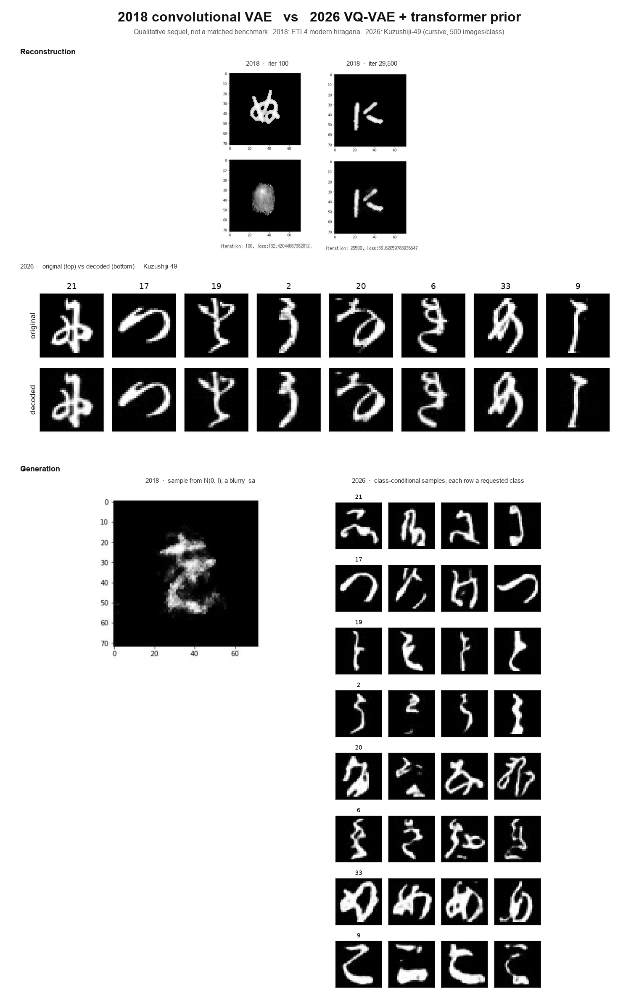

# Japanese handwriting with a VQ-VAE

A rebuild of a 2018 project that trained a convolutional VAE on ETL4 handwritten
hiragana. This version uses a VQ-VAE with a class-conditional transformer prior, so
you can ask for a specific character instead of sampling blindly.

**Status: Phase 1 on Kuzushiji-49 is complete.** The data pipeline, VQ-VAE, and
class-conditional transformer prior all train and sample locally. ETL4 is still
waiting on AIST's download site.

Original write-up: [Computer made Japanese letters through Variational
Autoencoder](https://medium.com/@tomernahshon/computer-made-japanese-letters-through-variational-autoencoder-2fdb5b6a0990)

Design: `docs/superpowers/specs/2026-11-05-japanese-vq-vae-design.md`

## Examples

The 2018 panels are from that blog post: a convolutional VAE on ETL4 hiragana.
The 2026 panels are a Kuzushiji-49 development run in this repo
(`configs/k49_dev.yaml`, 500 images per class). The datasets are different —
ETL4 is modern handwriting, K49 is kuzushiji — so this is a sequel, not a
scoreboard.



After training, the 2018 decoder could reconstruct a く, but sampling
`z ~ N(0, I)` produced a blurry さ. The VQ-VAE reconstructions are sharp;
new images come from the prior, so each sample row is a requested class.

Full-size 2026 grids:
[reconstructions](docs/figures/2026_vqvae_reconstructions.png),
[samples](docs/figures/2026_vqvae_samples.png).
2018 sources:
[early reconstruction](docs/figures/2018_vae_reconstruction_early.jpeg),
[late reconstruction](docs/figures/2018_vae_reconstruction_late.jpeg),
[generated さ](docs/figures/2018_vae_generated_sa.jpeg).

## Setup

Needs [uv](https://docs.astral.sh/uv/) and Python 3.12.

```bash
uv sync --python 3.12
uv run pytest
```

## Data

### Kuzushiji-49 (development)

Downloads without registration:

```bash
uv run jvqvae fetch-k49 --dest data/k49
```

### ETL4 (the real dataset)

ETL4 cannot be downloaded by this repository. AIST's Terms of Use permit
distribution only through their own site, so you must obtain it yourself:

1. Go to <https://etlcdb.db.aist.go.jp/>, accept the Terms of Use, and register to
   receive the download password.
2. Download ETL4 and place the zip at `data/raw/ETL4.zip`.
3. Run `uv run jvqvae ingest-etl4 --config configs/etl4.yaml`

Ingestion verifies the archive against AIST's published size and MD5 before parsing,
and asserts that it contains 6,120 records across 51 classes with 120 samples each.
If your archive differs, `--no-verify` skips the size and MD5 check and `--lenient`
skips the count assertions. Reach for them only to inspect a file that fails, not as
a habit: they exist to make a mismatch debuggable, not to paper over one.

## Using the data

`load_splits` takes a config and returns train, val and test; `CharacterTorchDataset`
wraps any of them for a `DataLoader`, yielding a `(1, H, W)` float tensor and an
integer class id:

```python
from torch.utils.data import DataLoader

from jvqvae.config import load_run_config
from jvqvae.data.pipeline import load_splits
from jvqvae.data.torch_dataset import CharacterTorchDataset

splits = load_splits(load_run_config("configs/etl4.yaml").data)
loader = DataLoader(CharacterTorchDataset(splits["train"]), batch_size=32, shuffle=True)
```

How a source gets divided is decided in one place, by the source itself. ETL4 carries
writer identities, so it is always split by writer: 96 writers train, 12 validate, 12
test, and no hand appears in two splits. K49 has no writer identities and ships its
own test set, so its validation set is carved at random out of the official train
portion. Asking for a writer split on a source without writers is an error, not a
silently random split.

## Training

One config file per dataset holds everything a run needs — the data source, the model
and the optimizer settings — so a run is reproducible from a single path.

```bash
uv run jvqvae train-vqvae --config configs/k49_dev.yaml
```

Add `--max-steps 20` for a smoke run, or `--device cpu` to override the automatic
MPS/CUDA/CPU choice. `configs/k49_dev.yaml` subsamples 500 images per class so a
development run stays fast; `configs/etl4.yaml` is the real thing. Each run writes two
checkpoints to `checkpoints/<name>/` (best by validation reconstruction, and last), a
reconstruction figure and a JSON record of every epoch to `results/<name>/`.

The per-epoch line reports train pixel reconstruction, the commitment term, validation
reconstruction (the number that picks the best checkpoint), codebook perplexity, and
how many of the 512 codes appeared at least once in the epoch. Watch the last of those:
codebook collapse, where nearly all the codes go unused, is the expected failure mode
at this data scale. Codes that stay unused are automatically restarted from live
encoder outputs, and the count of restarts is logged.

Once the VQ-VAE is trained, extract the discrete codes the prior will learn from:

```bash
uv run jvqvae extract-codes --config configs/k49_dev.yaml --split train
```

A VQ-VAE cannot generate on its own. It learns a code for an image and how to decode
one, but holds no distribution over code grids, so a grid sampled uniformly decodes to
noise. Train the prior on those codes, then sample. Sampling needs both checkpoints:
the prior draws a code grid and the VQ-VAE decodes it.

```bash
uv run jvqvae train-prior --config configs/k49_dev.yaml
uv run jvqvae sample --config configs/k49_dev.yaml
```

`train-prior` reads `results/<name>/codes_train.npz` by default and writes
`checkpoints/<name>/prior_best.pt` (and `prior_last.pt`) plus
`results/<name>/prior_run.json`. It does not sample. `sample` reads
`checkpoints/<name>/vqvae_best.pt` and `checkpoints/<name>/prior_best.pt` by
default and writes `results/<name>/samples.png`. Omit `--class` to draw every
class in the prior's class table; repeat `--class` to choose some. Add
`--sweep-class <id>` to also write `results/<name>/guidance_sweep.png`.

## Attribution

ETL4: Electrotechnical Laboratory, Japanese Technical Committee for Optical Character
Recognition, ETL Character Database, 1973-1984. Redistribution is not permitted, so
no ETL data appears in this repository.

Kuzushiji-49: "KMNIST Dataset" (created by CODH), adapted from "Kuzushiji Dataset"
(created by NIJL and others), doi:10.20676/00000341. Licensed CC BY-SA 4.0.

ETL record layout and character set details were cross-checked against the
MIT-licensed [choo/etlcdb-image-extractor](https://github.com/choo/etlcdb-image-extractor).

## Licence

The code in this repository is MIT licensed; see `LICENSE`. The datasets are not
covered by it and carry their own terms, noted above.
